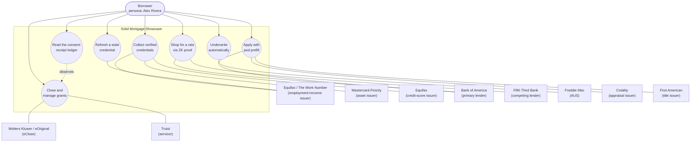

# Use Case: Borrower-Controlled Mortgage Origination on Solid

> Concept demonstration — not affiliated with or endorsed by Bank of America, Fifth Third
> Bank, Freddie Mac, Equifax, The Work Number, Mastercard, Finicity, Cotality, First American,
> Wolters Kluwer, eOriginal, Truist, USAA, GLEIF, EDM Council/OMG, MISMO, or the CFPB. Every
> stakeholder organisation named below is an *illustrative*, role-first casting ("modelled on
> X") chosen from `docs/research/org-map.md`; no logos, trade dress, insignia, or claims of
> deposit insurance/agency approval appear anywhere in the build (SPEC.md §6, decisions
> 0002 addendum R1–R8). This document follows the OMG / EDM Council use-case template (the
> standard EDMA UC format).

## I. Use Case Description

| Field | Value |
|---|---|
| **Use Case Name** | Borrower-Controlled Mortgage Origination on Solid |
| **Use Case Identifier** | SOLID-MTG-01 (bead `sm-gbjq`) |
| **Source** | Solid Mortgage Showcase — EDMA Solid Community of Practice |
| **Point of Contact** | Jesse Wright — `63333554+jeswr@users.noreply.github.com` |
| **Creation / Revision Date** | 2026-07-22 |
| **Associated Documents** | `SPEC.md` (design of record); `docs/research/mortgage-process.md`, `docs/research/org-map.md`, `docs/research/zkp-fit.md`, `docs/research/vocab.md`, `docs/research/showcase-framework-design.md`, `docs/research/showcase-patterns.md`; `packages/data-model/shapes/*.ttl` (SHACL); `e2e/journey.spec.ts` (executable five-scene traceability matrix); `decisions/0002`, `0004`–`0007`, `0010`, `0012`, `0015` |

## II. Use Case Summary

### Goal

Demonstrate, to EDMA member organisations, that putting a US mortgage borrower's verified
data in a **Solid pod they control**, wrapped as **reusable W3C Verifiable Credentials**, and
released only through **consented, receipted, revocable grants** — with **zero-knowledge
proofs** covering the one moment (pre-qualification shopping) where a property genuinely
should not be disclosed at all — removes the defining frictions of origination: repeated
document collection, stale verifications that force re-collection, PII copied across roughly
sixteen parties with no borrower visibility, and industry-scale breach exposure. Success for
this use case is each EDMA member organisation recognising its **own real seat** in the value
chain (the apps are cast 1:1 onto real GSE-accepted verifier/lender/servicer roles) and
choosing to sponsor the build-it-for-real partner phase.

### Requirements

Grounded in `docs/research/mortgage-process.md` §4 (pain points) and SPEC.md §1–2:

- **R1 — Reusable verification.** A verification issued once (employment+income, assets,
  credit score, appraisal, title) must be presentable to every downstream party as a signed
  VC, not re-collected. Metric: the demo must visibly skip the "same document, fourth party"
  loop that drives the avg. **$11,600 cost-to-originate** (Q3 2023 Freddie Mac Cost to
  Originate study; MBA 2025 puts it at $10,074–$12,603/loan).
- **R2 — Non-disclosure at shopping.** The borrower must be able to prove eligibility
  (`income ≥ $7,000/mo`, `credit score ≥ 620`) to **two competing lenders** without either
  lender learning the underlying values or pulling credit. Metric: zero raw income/score
  values transmitted in scene 2's network traffic — verifiable by proof structure, not by
  promise.
- **R3 — Freshness without re-collection.** A verification nearing its regulatory validity
  window (verbal VOE ≤ 10 business days before the note date — Fannie Selling Guide
  B3-3.1-04) must be refreshable with one click through an existing grant, not a phone call
  to the employer. The prior credential's status-list entry must be provably revoked.
- **R4 — Borrower visibility and control.** The borrower must be able to enumerate every
  party with access to their data, grant a new party (the incoming servicer), and revoke a
  party (the outgoing lender) — with every transition recorded in an auditable receipt
  ledger, addressing the finding that borrowers today "cannot enumerate who holds their
  file" (`mortgage-process.md` §3).
- **R5 — Regulatory timing fidelity.** Every timing beat dramatized must cite a real rule so
  EDMA members recognise their own compliance obligations: TRID Loan Estimate ≤ 3 business
  days of application; TRID Closing Disclosure ≥ 3 business days before consummation; verbal
  VOE ≤ 10 business days before the note (≤ 120 days self-employed); RESPA §1024.33 servicing
  transfer notices.
- **R6 — Semantic grounding.** All pod/credential data is expressed in real, dereferenceable
  vocabularies (FIBO-LOAN primary, schema.org, W3C VC 2.0, DPV, ODRL — no minted IRIs outside
  the one published project-residue namespace), so the demo also delivers the FIBO↔MISMO
  v3.4 binding table EDMA's CoP has asked for (SPEC.md §11).

### Scope

**In scope:** the five-scene borrower journey (SPEC.md §2) — credential issuance into the
pod; ZK pre-qualification shopping against two lenders; one-click application with pod
prefill and Loan Estimate delivery; pre-close freshness check and one-click re-issue with
provable revocation of the stale credential; eClosing, servicing-transfer grant, and lender
revocation with a consent-receipt ledger. Eight branded Next.js apps + one shared pod/wallet,
running against dev/e2e Solid pods (sparq `@jeswr/solid-server`, the WASM distribution) and,
for the deployed showcase, per-visitor in-browser pods plus read-only multiplexed org pods
(decision 0011).

**Explicitly out of scope for this use case (but in scope for a real build):** IRS 4506-C tax
transcript retrieval; UAD 3.6 appraisal XML internals beyond a single appraised-value VC;
ALTA title-commitment Schedule B detail beyond a single title-clear VC; MERS eNote
Authoritative-Copy transfer mechanics (referenced as a `mort:eNoteReference` field, never
played as a live registry transaction); full KERI/ACDC GLEIF vLEI issuance (the showcase
represents org identity as an LEI string + `gleif-L1:LegalEntity` typing, not a live vLEI
credential exchange); production-grade key custody, HSM signing, or externally-audited ZK
circuits (`docs/research/zkp-fit.md`: sparq's Noir/UltraHonk estate is research-grade,
pending cryptographer sign-off, bead `sq-qhy4`); real user authentication/account recovery
flows beyond a seeded demo login; and any real PII (every persona is fictional — see §III).

### Priority

Highest priority use case in the Solid Mortgage Showcase — this **is** the showcase; every
app, credential shape, and decision record exists to make this journey demonstrable end to
end (SPEC.md: "everything exists to make the five-scene demo land").

### Stakeholders

All stakeholder-app castings are illustrative role assignments from `docs/research/org-map.md`
(7 of 12 roles land on real EDMA members), carrying the non-affiliation disclaimer above and
role-first framing ("modelled on X") throughout the apps (decision 0002):

| Stakeholder | Role | EDMA member? |
|---|---|---|
| The borrower (persona: Alex Rivera) | Pod owner, principal actor | n/a — the person the showcase serves |
| **Bank of America** (modelled) | Primary lender/originator — full origination portal | Member |
| **Fifth Third Bank** (modelled) | Competing lender — thin pre-qual/rate-quote surface | Member, DEP Founder |
| **Equifax / The Work Number** (modelled) | Employment + income verification issuer | Not a member (external-approach target) |
| **Mastercard / Finicity** (modelled) | Asset / open-banking verification issuer | Member¹ |
| **Equifax** (modelled, credit bureau) | Credit-score verification issuer | Not a member |
| **Freddie Mac** (modelled, LPA/AIM-style) | Automated underwriting system (AUS) | Member, DEP Founder |
| **Cotality** (modelled, formerly CoreLogic) | Appraisal / valuation issuer | Not a member |
| **First American** (modelled) | Title search + title-clear issuer | Not a member |
| **Wolters Kluwer / eOriginal** (modelled) | eClosing / eNote / eVault platform | Member |
| **Truist** (modelled) | Loan servicer (post-close) | Member |
| **GLEIF** | Organisational identity authority (LEI, referenced not issued live) | Member |
| **EDM Council / OMG (FIBO)** with **MISMO** credited | Data/standards steward — the vocabulary this use case runs on | EDMA itself; MISMO not a member |
| CFPB (represented generically as "Examiner View") | Regulator lens — unbranded, explicitly non-affiliated | Not a member; no agency branding used |

¹ Mastercard's EDMA membership is sourced from an internal role-map sheet and is **publicly
unconfirmed** (`org-map.md` footnote, research-gaps C4) — flagged for re-verification before
any real outreach.

### Description

A US mortgage applicant today re-supplies the same income, asset, employment, and credit
facts to roughly sixteen distinct parties across a 41–44 day origination process (ICE
Mortgage Technology, 2024–2025), each of whom stores its own copy with no borrower visibility
into who holds what (`mortgage-process.md` §3–4). This use case replaces that pattern with a
**pod-centric, credential-based, consent-receipted** origination flow, played out as a
single borrower's five-scene journey across eight branded stakeholder applications that are
1:1 castings of real GSE-accepted verification suppliers, lenders, and the automated
underwriting system:

1. **Fill the vault** — three issuer apps sign employment+income, asset, and credit-score
   VCs directly into the borrower's pod.
2. **Shop without undressing** — the borrower proves `income ≥ $7,000/mo ∧ credit score ≥ 620`
   to two competing lenders via an in-browser zero-knowledge proof; neither lender ever
   receives the underlying numbers or pulls credit.
3. **One-click application** — the borrower picks a lender, grants scoped pod access, and the
   Uniform Residential Loan Application (URLA/Form 1003) prefills entirely from pod data; the
   Loan Estimate is delivered back into the pod inside the TRID 3-business-day window; the AUS
   underwrites instantly from the granted file.
4. **Nothing goes stale** — thirty (simulated) days later, the employment credential's
   validity window has lapsed under the 10-business-day verbal-VOE rule; a one-click re-issue
   through the existing grant replaces it, and the AUS re-runs and re-approves — no phone call
   to the employer, and the superseded credential is provably revoked via its status list.
5. **Close and stay in control** — the Closing Disclosure lands in the pod ≥ 3 business days
   early; the borrower eSigns through an eClosing app; the loan transfers to a servicer, who
   is newly granted access while the original lender's access is explicitly revoked by the
   borrower — all visible in a DPV consent-receipt ledger the borrower reads on-screen.

The principal actor throughout is the **borrower**, acting through a Data Vault (wallet) app
modelled on Verizon. Every other party is a secondary actor: an issuer, a verifier, an
underwriting service, or a closing/servicing party, each reached only through a borrower
grant or a borrower-initiated ZK proof presentation — never by silent third-party access.

### Actors / Interfaces

**Primary actor:** the borrower, via the `wallet` app (Verizon-modelled Data Vault) — the
only actor that both invokes the use case (by consenting to each flow) and receives its
benefit (a faster, cheaper, more visible origination).

**Secondary actors** (systems/services acted upon or acting at the borrower's direction; each
described further in §VIII where external to the use-case owner):

- **Issuer apps** (`apps/verifications`, three branded flows) — The Work Number/Finicity/
  Equifax-modelled issuers of employment+income, asset, and credit-score VCs.
- **Lender apps** — `apps/lender-boa` (Bank of America-modelled, full origination portal) and
  `apps/lender-53` (Fifth Third-modelled, thin competing pre-qual surface); each verifies ZK
  proofs and, for the chosen lender, reads pod-granted application data.
- **AUS app** (`apps/gse`, Freddie Mac LPA/AIM-modelled) — automated underwriting service;
  reads the granted loan file and every feeding credential, issues an `UnderwritingDecision`.
- **Property app** (`apps/property`) — two flows, Cotality-modelled appraisal and First
  American-modelled title, each issuing a credential into the pod.
- **Closing app** (`apps/closing`) — Wolters Kluwer(eOriginal)-modelled eClose surface and
  Truist-modelled servicer-transfer surface.
- **Tour app** (`apps/tour`) — EDMA CoP front door; not part of the borrower journey itself
  but the pitch surface that frames it, including the unbranded Examiner View.
- **Pod host** — sparq `@jeswr/solid-server` (WASM) in dev/e2e; per-visitor in-browser pods
  (Mode 1) or read-only multiplexed org pods (Mode 2a) when deployed (decision 0011).
- **FIBO/MISMO/W3C VC/DPV/ODRL vocabularies** — the knowledge resources every pod resource
  and credential is expressed against (§VIII).

### Pre-conditions

- The borrower has an authenticated Solid session (DPoP-bound Solid-OIDC) and a pod
  provisioned with a `borrower-profile` resource (`/mortgage/profile`).
- At least the three scene-1 issuer apps are reachable and hold valid signing keys registered
  against their issuer WebID documents (dereferenceable, per decision 0004's dual-signing —
  `eddsa-rdfc-2022` for the VC layer, Schnorr-over-Baby-JubJub for the ZK-attested
  commitment).
- Each issuer's Bitstring Status List 1.0 resource is reachable for revocation checks.
- No prior grant exists for the lender/servicer being newly granted in scenes 3 and 5 (a
  repeat close is refused with 409, per `e2e/journey.spec.ts` scene 5).

### Post-conditions

- The pod holds nine SHACL-validated resources: borrower profile; employment+income, asset,
  credit-score, appraisal, and title-clear credentials; loan application; underwriting
  decision; closing record.
- The lender and (after scene 5) the servicer hold live, WAC-granted read access to the
  closing record; the lender's grant has been explicitly revoked.
- A DPV consent-receipt ledger in the pod records every grant and revoke as an immutable
  history (three entries after scene 5: grant lender, grant servicer, revoke lender).
- The employment credential's original status-list index is revoked; its replacement carries
  an advanced `validUntil` window.

### Triggers

External/temporal: the borrower choosing to start the journey in the `wallet`/`tour` app
(external, user-initiated); the scene-4 freshness check firing because the employment
credential's validity window has lapsed relative to the 10-business-day verbal-VOE rule
(temporal); the scene-3 AUS run firing on the borrower's explicit "Run automated
underwriting" action over freshly granted data (internal, user-initiated per app UI, never
autonomous).

### Performance Requirements

- ZK proving: Tier A in-browser proofs (`filter_int_d3`/`d4`, income and credit-score
  thresholds) target sub-second to ~1.5 s per sub-proof with COOP/COEP-enabled multithreading
  (measured ~306–358 ms prove / ~63 ms verify at 8 threads, vs ~1.29 s / ~174 ms
  single-threaded — `docs/research/zkp-fit.md` Q2), because Vercel (unlike the sparq
  reference site) can set the required cross-origin-isolation headers.
- TRID compliance is a hard performance requirement of the flow itself: Loan Estimate ≤ 3
  business days of application; Closing Disclosure ≥ 3 business days before consummation.
- Every e2e-asserted app state passes an axe (WCAG 2.x A/AA) zero-violations check
  (`e2e/journey.spec.ts` runs `expectAxeClean` at every scene).
- Credential/status-list reads are simple GETs (no notifications in the sparq WASM server);
  freshness checks poll with `If-None-Match`.

### Assumptions

- Every credential-issuing "verifier" app in the demo *is* the seeded issuer identity (same
  IRI, same signing key) — a stand-in for the real vendor integration a partner-phase build
  would make over each org's actual API.
- The AUS decision logic is a simplified, illustrative rules engine (credit-score minimum,
  DTI, LTV, reserves, evidence-presence checks) — not Freddie Mac's real LPA/AIM logic.
- Demo personas are entirely fictional (see §III) and satisfy fair-lending posture: neither
  persona is styled as the "weak applicant", and no protected-class stereotyping is encoded
  in names/addresses (`packages/data-model/src/personas.ts` docblock).

### Open Issues

- Mastercard's EDMA membership status is internally sourced and publicly unconfirmed — must
  be re-verified before any real partner outreach naming Mastercard/Finicity (`org-map.md`
  footnote 1; research-gaps C4).
- No EDMA member exists for credit bureau, residential appraisal, title, or the regulator
  role — these are external-approach targets for the partner phase (`org-map.md` "Gaps and
  cautions").
- The sparq ZK estate (Noir/UltraHonk circuits underlying scene 2) is not yet externally
  audited by a cryptographer (bead `sq-qhy4`) — every ZK-proving surface must keep its
  honesty panel live until that lands.
- The residue vocabulary `mort:` is published at `https://solid-mortgage-vocab.vercel.app/mort#`
  pending Jesse's decision on whether to alias it to a custom domain before further terms are
  minted (decision 0010).

## III. Usage Scenarios

Both scenarios use **fictional demo personas only** — no real PII anywhere in this document
or in the underlying seed data (`packages/data-model/src/personas.ts`). Values are chosen to
be internally consistent, URLA-realistic, and to clear the demo's ZK thresholds without any
persona being cast as financially weaker than the other (fair-lending posture, see
Assumptions).

**Scenario 1 — Alex Rivera, first-time purchase, rate-shopping under time pressure.**
Alex Rivera (persona; senior data engineer, Ridgeline Analytics LLC, Columbus, OH;
`monthlyGrossIncomeUsd: 8200`, `creditScoreValue: 745`) wants to make an offer on a house at
1121 Maple Hollow Court within the week and doesn't want four separate lenders pulling credit
before deciding who to apply with. Alex first collects verified employment+income, asset, and
credit-score credentials into their pod through the three verification-issuer apps (scene 1).
Rather than filling out four separate pre-qualification forms with raw income and credit
detail, Alex uses the wallet's zero-knowledge proving flow to prove *"income ≥ $7,000/month
and credit score ≥ 620"* to the Bank-of-America-modelled lender and the Fifth-Third-modelled
competing lender simultaneously (scene 2) — receiving two illustrative rate quotes without
either lender learning Alex's actual income or score, and without a hard credit pull at
either. Alex picks the Bank-of-America-modelled lender, grants it scoped pod access, and
watches the URLA prefill automatically from the pod (name, employer, income, the already-clear
title and appraisal on file) — submitting in under a minute instead of re-typing everything
(scene 3). The Loan Estimate lands back in Alex's pod inside the TRID 3-day window, and the
Freddie-Mac-modelled AUS returns an instant "Approve" recommendation reading the same granted
data. This scenario exercises the ontology-driven requirement most directly: the credential
shapes (`EmploymentIncomeCredential`, `CreditScoreCredential`) must carry enough FIBO-typed
structure (`fibo-loan-ln-app:BorrowerMonthlyIncome`, `fibo-fnd-arr-rt:hasRatingScore`) that a
lender's SPARQL-driven prequalification engine can evaluate eligibility purely from typed
triples, with the ZK layer never touching a value the ontology itself discloses.

**Scenario 2 — Jordan Avery, pre-close freshness and the servicing handoff.**
Jordan Avery (persona; operations manager, Harborview Logistics Inc., Westerville, OH;
`monthlyGrossIncomeUsd: 7400`, `creditScoreValue: 701`) applied and was approved thirty days
ago. Jordan's lender runs the mandatory pre-close verbal-VOE-equivalent freshness check
required within 10 business days of the note date (Fannie Selling Guide B3-3.1-04) and finds
the seeded employment credential's `validUntil` window has genuinely lapsed (the persona was
seeded backdated `validFrom −30d / validUntil +14d`, per decision 0012 — "no fake clock").
Instead of the employer receiving a phone call, Jordan clicks "Re-issue" in the verifications
app; the employment-verifier-modelled issuer re-signs a fresh credential through the *same*
existing grant, and the pod-hosted Bitstring Status List is updated so the prior credential's
status index (42, in the seed canon) is provably revoked — a subsequent verification attempt
against the old credential fails closed with `STATUS_REVOKED`. The AUS re-runs automatically
over the replacement and re-approves. At closing, the loan is sold and Jordan's servicing
transfers from the originating lender to the Truist-modelled servicer (RESPA §1024.33): Jordan
approves the new servicer's access grant and revokes the original lender's access in the same
screen, then reads the consent-receipt ledger to see the full grant/grant/revoke history. This
scenario exercises the freshness-vs-revocation requirement (R3) and the visibility/control
requirement (R4): the "green tick" freshness check and the ledger both depend on being able to
query, over real provenance metadata (`cred:validFrom`/`validUntil`, `dpv:hasConsentStatus`),
*who currently holds access and since when* — not merely whether a document exists.

## IV. Basic / Normal Flow of Events

This is the composite flow across scenarios 1 and 2 above, mirroring the five scenes asserted
end-to-end in `e2e/journey.spec.ts` (sm-36) against the seeded pod. Each scene is a real state
transition on the pod (a credential written, a proof verified, a grant recorded), not a
simulated screen transition — the e2e suite treats the flow below as its literal test
oracle.

| Step | Actor (Person) | Actor (System) | Description |
|---|---|---|---|
| 1 | Borrower | `apps/verifications` (employment flow) | Employer-modelled issuer (The Work Number/Finicity/Equifax) signs an `EmploymentIncomeCredential` (backdated `validFrom −30d/+14d`) into `/mortgage/credentials/income`, subject-bound to the borrower's WebID. |
| 2 | Borrower | `apps/verifications` (asset flow) | Bank/aggregator-modelled issuer signs an `AssetCredential` into `/mortgage/credentials/assets`. |
| 3 | Borrower | `apps/verifications` (credit flow) | Bureau-modelled issuer signs a `CreditScoreCredential` into `/mortgage/credentials/credit`. |
| 4 | Borrower | `apps/wallet` | Borrower reviews the three issued VCs in the Data Vault; each shows verified (signature + issuer trust + window + not-revoked). |
| 5 | Borrower | `apps/lender-boa`, `apps/lender-53` | Both lenders mint a per-session challenge nonce (`api/prequal/challenge`). |
| 6 | Borrower | Wallet (in-browser ZK prover) | Borrower proves `monthlyGrossIncomeUsd ≥ 7000` and `creditScoreValue ≥ 620` in-tab (Tier A, UltraHonk), each proof bound to the issuer-signed operand-anchor VC and the lender's nonce — no raw value ever leaves the browser. |
| 7 | — | Both lender apps | Each lender independently verifies its proof (`api/prequal/verify`) and returns an illustrative, non-binding rate quote (`illustrative: true`, `notAnOffer: true`); no credit pull occurs. |
| 8 | Borrower | `apps/lender-boa` | Borrower selects Bank-of-America-modelled lender and grants scoped pod access. |
| 9 | — | `apps/lender-boa` | URLA/Form 1003 prefills entirely from pod data (`data-prefill-source="pod"`): name, employer, income, prior title/appraisal on file. |
| 10 | Borrower | `apps/lender-boa` | Borrower submits; the application document overwrites `/mortgage/application` (`submittedBy` = borrower WebID) and the Loan Estimate is delivered into the pod inside the TRID 3-business-day window. |
| 11 | Borrower | `apps/gse` | Borrower triggers "Run automated underwriting"; the AUS reads the granted loan file plus every feeding credential (employment, assets, credit, appraisal, title). |
| 12 | — | `apps/gse` | AUS evaluates findings (credit-score minimum, DTI, LTV, reserves, evidence-presence) and writes an `UnderwritingDecision` (Approve) to `/mortgage/decision`, `dcterms:creator` = the AUS service identity. |
| 13 | — (temporal) | `apps/lender-boa` | Thirty (simulated) days later, the pre-close freshness check runs against the employment credential; its validity window has lapsed under the 10-business-day rule. |
| 14 | Borrower | `apps/verifications` (employment flow) | Borrower clicks "Re-issue (freshness)"; the issuer re-signs a replacement credential through the existing grant and revokes the prior status-list index. |
| 15 | — | `apps/gse` | AUS re-runs automatically over the replacement credential and re-approves. |
| 16 | — | `apps/closing` | Closing Disclosure is delivered into the pod ≥ 3 business days before consummation (TRID). |
| 17 | Borrower | `apps/closing` (eClose) | Borrower eSigns; a `ClosingRecord` is written to the pod and the lender is granted Read on the record's ACL. |
| 18 | Borrower | `apps/closing` (servicer transfer) | Borrower approves the Truist-modelled servicer's access grant (RESPA §1024.33 notice framing). |
| 19 | Borrower | `apps/closing` | Borrower revokes the originating lender's access; the ACL rule naming the lender is removed. |
| 20 | Borrower | `apps/closing` / `apps/wallet` | Borrower reads the DPV consent-receipt ledger: grant (lender) → grant (servicer) → revoke (lender), each a receipted, timestamped entry. |

## V. Alternate Flow of Events

**V.a — Unresponsive verification issuer.** If an issuer app cannot be reached at scene 1
(network failure, issuer service down), the wallet shows a live-status indicator ("not
deployed"/"unreachable") rather than blocking silently, mirroring the framework's honest
degradation pattern (`docs/research/showcase-patterns.md`); the borrower can retry or proceed
with whichever credentials did land, and any lender-side flow that depends on a missing
credential fails closed rather than proceeding without evidence.

| Step | Actor (Person) | Actor (System) | Description |
|---|---|---|---|
| 1 | Borrower | `apps/verifications` | Borrower requests credential issuance. |
| 2 | — | `apps/verifications` | Issuer request fails or times out. |
| 3 | — | wallet/verifications UI | Borrower is shown an honest failure state, not a spinner or a silently mocked success. |
| 4 | Borrower | `apps/verifications` | Borrower retries; on repeated failure, proceeds to scene 2 with fewer credentials, and any lender check requiring the missing evidence explicitly reports it absent. |

**V.b — Revoked or expired credential presented.** If a credential's status-list entry has
been revoked (e.g. mid-flow re-issue superseding the original) or its validity window has
lapsed and no re-issue has happened, any verifier — lender pre-qual, AUS, freshness check —
must fail closed.

| Step | Actor (Person) | Actor (System) | Description |
|---|---|---|---|
| 1 | — | Verifier (lender / AUS / freshness check) | Verifier runs the full `verifyCredential` chain: signature, issuer trust, validity window, Bitstring Status List lookup, SHACL shape. |
| 2 | — | Verifier | Status-list lookup returns revoked, or `now > validUntil`. |
| 3 | — | Verifier | Verification returns `verified: false` with an explicit error code (`STATUS_REVOKED` or a window-expiry code) — never a silent pass. |
| 4 | Borrower | `apps/verifications` | Borrower is directed to the re-issue flow (Basic Flow step 14) rather than the flow proceeding on stale evidence. |

**V.c — ZK proof fails verification (forged/mis-bound proof, stale nonce, missing anchor).**
Because a bare Tier-A filter proof is cryptographically forgeable without the issuer-signed
operand-anchor VC (decision 0012), the lender's verifier must reject any presentation that
fails the anchor check, the nonce-freshness check, or the DPoP-WebID-equals-subject check.

| Step | Actor (Person) | Actor (System) | Description |
|---|---|---|---|
| 1 | Borrower | Wallet (in-tab prover) | Borrower generates a Tier-A proof for a statement. |
| 2 | — | Lender verify route | Verifier checks: anchor VC signature valid; `anchor.operandEnc == proof public input`; DPoP-bound WebID equals `credentialSubject.id`; nonce is fresh and single-use. |
| 3 | — | Lender verify route | Any check fails → `qualified: false`, proof rejected, no rate quote issued. |
| 4 | Borrower | Wallet | Borrower is shown the honesty-panel explanation (proof rejected, why) and may re-attempt with a fresh challenge. |

**V.d — Underwriting decline / refer.** The AUS may return `Deny`, `Refer`, or
`UnableToDetermine` (FIBO `UnderwritingDecision-*` named individuals) rather than `Approve` —
e.g. if a required credential's evidence is missing or a threshold (credit-score minimum,
DTI, LTV, reserves) fails.

| Step | Actor (Person) | Actor (System) | Description |
|---|---|---|---|
| 1 | Borrower | `apps/gse` | Borrower runs automated underwriting. |
| 2 | — | `apps/gse` | One or more findings (e.g. `DEBT_TO_INCOME`, `LOAN_TO_VALUE`) fail. |
| 3 | — | `apps/gse` | `UnderwritingDecision` is written with a non-Approve status (`mort:DecisionStatus-Denied`/`-Suspended`/`-ApprovedWithConditions`) and the failing findings are shown per-code, not summarised away. |
| 4 | Borrower | `apps/gse` / `apps/lender-boa` | Borrower sees exactly which finding failed and can address it (e.g. re-issue a credential, adjust the requested amount) before re-running. |

**V.e — Repeat/duplicate closing attempt.** The closing app must refuse a second close on an
already-closed record rather than allow the lender grant to be silently re-created after
revocation.

| Step | Actor (Person) | Actor (System) | Description |
|---|---|---|---|
| 1 | Borrower | `apps/closing` | A `ClosingRecord` already exists at `/mortgage/closing-record`, and the lender's access has already been revoked. |
| 2 | Borrower | `apps/closing` | Borrower (or a replayed request) attempts to close again. |
| 3 | — | `apps/closing` | Request is refused with HTTP 409; the ACL is confirmed unchanged (the revoked lender is not restored). |

## VI. Use Case and Activity Diagram(s)

**Figure 1 — Use case diagram: borrower and the eight branded stakeholder roles.**

**Figure 2 — Activity diagram: the five-scene flow (mirrors `e2e/journey.spec.ts`).**

```mermaid
flowchart TD
    Start([Borrower starts the journey]) --> S1

    subgraph S1["Scene 1 — Fill the vault"]
        direction TB
        A1[Employment issuer signs<br/>EmploymentIncomeCredential] --> A2[Asset issuer signs<br/>AssetCredential]
        A2 --> A3[Bureau issuer signs<br/>CreditScoreCredential]
    end

    S1 --> S2

    subgraph S2["Scene 2 — Shop without undressing"]
        direction TB
        B1[Both lenders mint<br/>challenge nonces] --> B2[Borrower proves income greaterorequal T<br/>AND score greaterorequal 620 in-browser]
        B2 --> B3{Anchor + nonce<br/>+ WebID checks pass?}
        B3 -->|no| B4[qualified: false<br/>no quote]
        B3 -->|yes| B5[Illustrative rate quotes<br/>from both lenders]
    end

    S2 --> S3

    subgraph S3["Scene 3 — One-click application"]
        direction TB
        C1[Borrower picks a lender,<br/>grants scoped pod access] --> C2[URLA prefills from pod]
        C2 --> C3[Submit: application +<br/>Loan Estimate land in pod]
        C3 --> C4[AUS reads granted file<br/>+ all credentials]
        C4 --> C5{Findings pass?}
        C5 -->|yes| C6[UnderwritingDecision: Approve]
        C5 -->|no| C7[Decision: Deny / Refer /<br/>Suspended, with failing codes]
    end

    S3 --> S4

    subgraph S4["Scene 4 — Nothing goes stale"]
        direction TB
        D1[Pre-close freshness check:<br/>employment window lapsed] --> D2[Borrower one-click re-issues<br/>through existing grant]
        D2 --> D3[Old status index REVOKED;<br/>new credential + anchor issued]
        D3 --> D4[AUS re-runs to Approve]
    end

    S4 --> S5

    subgraph S5["Scene 5 — Close and stay in control"]
        direction TB
        E1[Closing Disclosure delivered<br/>greaterorequal 3 business days early] --> E2[Borrower eSigns:<br/>ClosingRecord written]
        E2 --> E3[Lender granted Read<br/>on the record's ACL]
        E3 --> E4[Borrower grants servicer]
        E4 --> E5[Borrower revokes lender]
        E5 --> E6[Consent-receipt ledger:<br/>grant / grant / revoke]
    end

    S5 --> End([Borrower reads the<br/>full access history])
```

## VII. Competency Questions

Grounded exclusively in the real, dereferenceable IRIs the pod/credential data is actually
expressed in (`packages/data-model/src/vocab/{external,mort}.ts`, `docs/research/vocab.md`):
FIBO-LOAN (`https://spec.edmcouncil.org/fibo/ontology/LOAN/...`), FIBO-FND
(`.../FND/Arrangements/Assessments/`, `.../FND/Places/RealProperty/`), schema.org
(`https://schema.org/`), W3C VC 2.0 (`https://www.w3.org/2018/credentials#`), DPV
(`https://w3id.org/dpv#`), ODRL (`http://www.w3.org/ns/odrl/2/`), and the project residue
vocabulary published at `https://solid-mortgage-vocab.vercel.app/mort#` (decision 0010). No
IRI in this section is minted for this document — every one already appears in a committed
SHACL shape or typed wrapper.

**CQ1 — "Is this borrower's employment/income evidence still fresh enough to close, and if
not, when was it last refreshed and by whom?"**

This is exactly the scene-4 freshness check. Starting from the credential at
`/mortgage/credentials/income`, typed `cred:VerifiableCredential` with subtype
`mort:EmploymentIncomeCredential`, the answer walks: `cred:issuer` (the employment-verifier
issuer WebID) → `cred:validFrom`/`cred:validUntil` (the statement window) →
`cred:credentialStatus` (the Bitstring Status List entry) → the FIBO
`fibo-loan-ln-app:IncomeVerificationReport` reached via `cred:evidence`. A SPARQL query over
the pod (through `@jeswr/fetch-rdf` + `@solid/object` typed accessors) asks: does
`now` fall within `[validFrom, validUntil]`? Does a `GET` on the status-list resource show the
credential's indexed bit as unset? Example answer (from the seeded scene-4 state): "No — the
credential's `validUntil` was `seededAt + 14 days`, which has passed; it was superseded on
`<re-issue timestamp>` by the employment-verifier issuer through the existing grant, and the
old status index 42 is now set (revoked)." **Why provenance beats the obvious alternative:**
the obvious alternative is a lender calling the employer directly (today's actual practice for
verbal VOE) or trusting a cached PDF with no queryable expiry — neither is machine-checkable
in real time. Because `validFrom`/`validUntil`/`credentialStatus` are typed VC-vocabulary
triples rather than fields buried in a vendor PDF, freshness becomes a sub-second SPARQL
`ASK`/status-list `GET`, and — critically — the *history* of re-issuance (who issued the
replacement, when, and that the old one is now cryptographically dead) is queryable
provenance, not something a phone call could ever produce.

**CQ2 — "For this loan application, what evidence supports the underwriting decision, and
does the loan-to-value ratio implied by the appraisal actually satisfy the decision's stated
LTV finding?"**

Starting from `/mortgage/decision`, typed `fibo-loan-ln-app:UnderwritingDecision`, the answer
follows `fibo-fnd-rel-rel:evaluates` (from `packages/data-model` — the FIBO `Relations`
module's generic relation, used because a FIBO-specific "decision evaluates application"
property was not found in the released module) to the `fibo-loan-ln-app:LoanApplication` at
`/mortgage/application`, and from there `fibo-loan-ln-ln:hasPrincipalAmount`/
`fibo-loan-ln-app:hasRequestedAmount` (the loan amount) alongside the property's
`fibo-fnd-arr-asmt:AppraisedValue` (via `fibo-fnd-arr-asmt:hasEstimatedValue` on the
appraisal credential at `/mortgage/credentials/appraisal`, `schema:PostalAddress`-located).
A SPARQL query joins these two typed numeric facts and recomputes
`loanAmount / appraisedValue` to cross-check the `fibo-loan-ln-ln:LoanToValueRatio` finding
the AUS recorded. Example answer (seeded persona Alex Rivera): requested/approved amount
$340,000 against an appraised value of $425,000 → LTV = 80.0%, consistent with the AUS's
`LOAN_TO_VALUE` finding reported as `pass`. **Why the semantic/provenance approach beats the
obvious alternative:** the obvious alternative is trusting the AUS's PDF findings report as an
opaque pass/fail — exactly what happens today (`mortgage-process.md` §3: "DU Findings Report,
PDF + JSON"). Because both the input facts (requested amount, appraised value) and the
decision's stated finding are typed FIBO triples in the *same* pod, a lender's own QA process
— or an EDMA member auditing the showcase — can **independently recompute** the ratio from
the underlying evidence rather than trusting the underwriter's summary number, and can trace
the appraisal back to its issuer (`fibo-fnd-arr-asmt:Appraiser` = Cotality-modelled AMC) and
signing date. That auditability is the point of putting underwriting evidence in an ontology
rather than a report.

## VIII. Resources

### Knowledge Bases, Repositories, or other Data Sources

| Data | Type | Description | Owner | Source | Access Policies & Usage |
|---|---|---|---|---|---|
| Borrower pod (per-persona) | Remote (in-browser SharedWorker pod, Mode 1; or multiplexed org pod, Mode 2a) | Nine SHACL-validated Turtle/JSON-LD resources per persona: profile, five credentials, application, decision, closing record | Borrower (WebID-controlled) | sparq `@jeswr/solid-server` (WASM) dev/e2e instance; deployed per decision 0011 | WAC-controlled; borrower is the owner; grants scoped and revocable; `lint:iris` + pyshacl gate CI |
| `mortgage-process.md` quantified anchors | Local (in-repo research doc) | Cost-to-originate, days-to-close, verification timing rules, breach figures, all web-verified July 2026 | Solid Mortgage Showcase research | `docs/research/mortgage-process.md`, citing CFPB/Fannie/Freddie/MBA/ICE/NYDFS sources | Free; internal research artifact |
| `org-map.md` stakeholder assignments | Local (in-repo research doc) | Real-org-to-role mapping, EDMA member directory snapshot 4 Jun 2026, market-share sourcing | Solid Mortgage Showcase research | `docs/research/org-map.md` | Free; internal EDMA-sheet snapshot cited, re-verify before outreach |
| `packages/data-model/shapes/*.ttl` | Local (in-repo SHACL) | Nine closed SHACL shapes constraining every pod resource | Solid Mortgage Showcase | `packages/data-model/shapes/` | Open (private repo today); validated in CI via pyshacl |
| Bitstring Status List 1.0 resources (per issuer) | Remote (pod-hosted) | Revocation state for every issued credential | Each modelled issuer app | `apps/verifications` (and property/closing apps) at `<issuer-origin>/status/<list>` | Public-read within the demo pod; fail-closed on lookup failure |

### External Ontologies, Vocabularies, or other Model Services

| Resource | Language | Description | Owner | Source | Describes/Uses | Access Policies & Usage |
|---|---|---|---|---|---|---|
| FIBO — LOAN domain (Loans, LoanApplications, Mortgages, MortgageOrigination) | OWL, RDF/XML + Turtle | Loan/mortgage/application/underwriting classes and URLA-aligned controlled vocabularies (loan purpose, occupancy, amortization type) | Joint copyright: EDM Council + Object Management Group | `https://spec.edmcouncil.org/fibo/ontology/LOAN/...` (Release for Loans/Mortgages; Provisional for LoanApplications/MortgageOrigination) | Loan application, underwriting decision, closing record resources | Free; version-pinned per release, re-checked quarterly (Provisional modules can rename terms) |
| FIBO — FND domain (Assessments, RealProperty, Ratings, Relations) | OWL, Turtle | Appraisal, real property, rating-scale, and generic relation classes | EDM Council + OMG | `https://spec.edmcouncil.org/fibo/ontology/FND/...` | Appraisal credential, property, credit-score rating | Free |
| FIBO — FBC domain (DebtAndEquities: Debt, CreditRatings) | OWL, Turtle | Borrower/Lender/Creditor roles; credit-report/rating classes | EDM Council + OMG | `https://spec.edmcouncil.org/fibo/ontology/FBC/...` | Borrower profile, credit-score credential | Free |
| MISMO Reference Model v3.4 | XML Schema (no RDF form) | Industry-standard ULAD/URLA field dataset; mapped, not directly used, as RDF | Mortgage Bankers Association (MISMO subsidiary) | `https://www.mismo.org/standards-resources/mismo-product/mismo-version-3-4` | Documentation-level field mapping only — `docs/mismo-mapping.md` binds each pod/credential field to its MISMO v3.4 data point/ULAD ID | Free for participation; workgroups open to non-members |
| W3C Verifiable Credentials Data Model 2.0 | RDFS vocab (Turtle) + JSON-LD context | Credential envelope terms: `VerifiableCredential`, `credentialSubject`, `issuer`, `validFrom`/`validUntil`, `credentialStatus`, `evidence` | W3C | `https://www.w3.org/2018/credentials#`; context `https://www.w3.org/ns/credentials/v2` | Every one of the five issued credentials | Free, open W3C Recommendation-track standard |
| schema.org | RDFS/JSON-LD vocab | Person, address, employment, monetary-amount, bank-account terms | schema.org community group (Google/Microsoft/Yahoo/Yandex-founded) | `https://schema.org/` | Borrower profile, employment display fields, property address | Free |
| DPV (Data Privacy Vocabulary) 2.x | RDFS/OWL, Turtle | Consent, purpose, legal-basis terms for the receipt ledger | W3C Data Privacy Vocabularies and Controls CG | `https://w3id.org/dpv` | Consent-receipt resources written on every grant/revoke | Free |
| ODRL 2.2 | RDFS/OWL, Turtle | Policy/permission/prohibition/duty terms expressing usage terms WAC cannot | W3C | `http://www.w3.org/ns/odrl/2/` | Grant policies attached via `cred:termsOfUse`; access-manager pipeline | Free |
| `mort` — project residue vocabulary | Turtle + JSON-LD + HTML (pyLODE), hash namespace | Title status, decision statuses, ZK scaled-unit integer fields, marital status — terms with no fit in FIBO/schema.org/DPV | Solid Mortgage Showcase (Jesse Wright) | `https://solid-mortgage-vocab.vercel.app/mort#` (decision 0010; dedicated Vercel project, independent of app renames) | Credential subtypes, decision statuses, ZK-provable numeric fields | Free; CI asserts every used `mort:` term exists in the published file; no term minted before the project is live |
| GLEIF L1 ontology (LEI) | OWL, Turtle (ontology-level deref only; term IRIs 404) | Legal-entity identity terms | GLEIF | `https://www.gleif.org/ontology/L1/` | Stakeholder org identity, referenced by LEI string (real LEIs where they exist; no fabricated IDs) | Free; term-level IRIs do not dereference — namespace-granularity only |

### Other Resources, Services, or Triggers

| Resource | Type | Description | Owner | Source | Access Policies & Usage |
|---|---|---|---|---|---|
| sparq `@jeswr/solid-server` (WASM distribution) | Dev/test service | Solid pod server hosting all demo pods in dev/e2e; per-visitor in-browser instances in the deployed showcase | sparq-org | Vendored packed tarball, `packages/solid-kit` harness | Free; per-suite in-memory instances on random ports |
| sparq Noir/UltraHonk ZK stack | Cryptographic service (in-browser + native) | Tier-A live in-browser proving (`filter_int_d3`/`d4`); Tier-B native-precomputed manifests for composed proofs | sparq-org | `@noir-lang/noir_js` + `@aztec/bb.js`, pinned versions | Free/open-source; research-grade, pending external cryptographer audit (`sq-qhy4`) — honesty panel mandatory on every proving surface |
| `@jeswr/solid-vc` | Library | Issue + verify VCs fail-closed against pod-hosted issuer docs and status lists | jeswr / solid-sdk | npm workspace package | Internal; consumed by every issuer app |
| `@jeswr/fetch-rdf`, `@solid/object`, `@rdfjs/wrapper` | Libraries | RDF fetch/parse and typed pod-resource accessors — the mandatory RDF-discipline seam (no hand-parsed Turtle/ACL) | jeswr / solid-community | npm workspaces | Internal; used by every app touching pod data |
| Vercel (per-app projects + multi-zones shell) | Hosting/deploy service | Eight Vercel projects served under one shared demo domain via Next.js multi-zones; COOP/COEP headers on proving surfaces | Vercel | `docs/deploy.md`, SPEC.md §8 | Free tier; deterministic aliases; per-app `vercel.json` + `turbo-ignore` |
| roborev (codex / gpt-5.6-sol) | CI review service | Automated per-commit review, min severity low | Internal tooling | `.roborev.toml` | Runs async on every commit |

## IX. References and Bibliography

**Regulatory / standards references** (all verified against CFPB/GSE sources as of July 2026,
per `docs/research/mortgage-process.md`):

- CFPB — Prequalification vs. preapproval: https://www.consumerfinance.gov/ask-cfpb/whats-the-difference-between-a-prequalification-letter-and-a-preapproval-letter-en-127/
- CFPB — TRID Loan Estimate / Closing Disclosure timing: https://www.consumerfinance.gov/know-before-you-owe/ and https://www.consumerfinance.gov/ask-cfpb/when-do-i-get-a-closing-disclosure-en-179/
- CFPB — Regulation B §1002.14 (appraisal copy delivery): https://www.consumerfinance.gov/rules-policy/regulations/1002/14/
- CFPB — Regulation X §1024.33 (servicing transfer notices): https://www.consumerfinance.gov/rules-policy/regulations/1024/33/
- Fannie Mae Selling Guide B3-3.1-04 — verbal VOE (10 business days / 120 days self-employed): https://selling-guide.fanniemae.com/sel/b3-3.1-04/verbal-verification-employment
- Fannie Mae Selling Guide B1-1-03 — allowable age of credit documents (4 months): https://selling-guide.fanniemae.com/sel/b1-1-03/allowable-age-credit-documents-and-federal-income-tax-returns
- Fannie Mae — Day 1 Certainty / DU validation service (up to 12 days saved): https://singlefamily.fanniemae.com/applications-technology/day-1-certainty
- Fannie Mae — URLA / ULAD mapping: https://singlefamily.fanniemae.com/delivering/uniform-mortgage-data-program/uniform-residential-loan-application
- Freddie Mac — 2024 Cost to Originate Study: https://sf.freddiemac.com/docs/pdf/cost-to-originate-full-study-2024.pdf
- Freddie Mac — AIM service providers: https://sf.freddiemac.com/tools-learning/technology-tools/our-solutions/aim-service-providers
- MBA — IMB production-cost data (2025/Q3 2025): https://www.mba.org/news-and-research/newsroom/news/2026/04/16/independent-mortgage-bankers-post-improved-net-production-profits-in-2025
- ICE Mortgage Technology (via Rocket Mortgage) — 41–44 days average time to close: https://www.rocketmortgage.com/learn/time-to-close-on-a-house
- MERS — eRegistry FAQ: https://www.mersinc.org/products-services/mers-esuite/eregistry/faq
- Mr. Cooper breach (14.7M people, 2023) — BleepingComputer: https://www.bleepingcomputer.com/news/security/mortgage-giant-mr-cooper-data-breach-affects-147-million-people/
- First American 885M-document exposure, $1M NYDFS settlement — Cybersecurity Dive: https://www.cybersecuritydive.com/news/new-york-1m-settlement-first-american/700849/

**Standards / ontologies:**

- FIBO home / governance: https://spec.edmcouncil.org/fibo/ and https://github.com/edmcouncil/fibo
- MISMO Reference Model v3.4: https://www.mismo.org/standards-resources/mismo-product/mismo-version-3-4
- W3C VC Data Model 2.0: https://www.w3.org/TR/vc-data-model-2.0/
- W3C VC Data Integrity, eddsa-rdfc-2022: https://www.w3.org/TR/vc-di-eddsa/
- W3C VC Data Integrity BBS cryptosuite (selective disclosure only, no range proofs): https://www.w3.org/TR/vc-di-bbs/
- schema.org: https://schema.org/
- DPV 2.x: https://w3id.org/dpv
- ODRL 2.2: http://www.w3.org/ns/odrl/2/
- GLEIF vLEI: https://www.gleif.org/en/vlei/introducing-the-verifiable-lei-vlei
- Solid protocol (WAC access control): https://solidproject.org/TR/wac

**Ontologies considered but not used, and why:**

- **BBS+ / `bbs-2023` Data Integrity cryptosuite** — provides selective disclosure and
  unlinkable derived proofs only, not range/predicate proofs over hidden values; the
  showcase's threshold statements (`income ≥ T`) need the latter, so ZK routes through
  sparq's Noir/UltraHonk engine instead (`docs/research/zkp-fit.md` Q1, `vocab.md` §6 point 7).
- **KERI/ACDC vLEI credentials (native GLEIF format)** — not W3C JSON-LD VCs, so out of scope
  for the pod's RDF model; org identity is represented as an LEI string + `gleif-L1:LegalEntity`
  typing instead (`vocab.md` §3.5).
- **A bespoke project ontology for loan/mortgage concepts** — rejected in favour of FIBO-LOAN,
  which was found to already cover loans, mortgages, applications, underwriting, and
  URLA-aligned controlled vocabularies at real dereferenceable IRIs; only a small residue
  (title status, decision-status individuals, ZK-scaled numeric fields) needed a project
  vocabulary at all (`vocab.md` §1 recommendation).

**Internal design-of-record documents:**

- `SPEC.md` — design of record for the full showcase
- `docs/research/mortgage-process.md`, `org-map.md`, `zkp-fit.md`, `vocab.md`,
  `showcase-framework-design.md`, `showcase-patterns.md`, `regn-optics.md`
- `decisions/0002` (app set + branding), `0004` (VC rails), `0005` (ZK encodings), `0006`
  (consent-receipt ledger), `0007` (freshness vs. revocation), `0010` (vocab hosting), `0012`
  (presentation protocol), `0015` (cross-app auth model)
- `e2e/journey.spec.ts` — the executable, five-scene traceability matrix this document mirrors

## X. Notes

**What is simulated vs. what a real build would add** (honesty note, matching the pattern in
research: every branded surface carries `simulated: true` on API payloads and an unremovable
ConceptDemoBanner — SPEC.md §4, §6):

- **Real in this demo, nothing mocked on the credential/proof/grant path:** every credential
  signature (issuer apps sign as the seeded issuer identities with real keys); every
  `verifyCredential` chain (signature, issuer trust, validity window, status-list lookup,
  SHACL shape) fail-closed against pod-served documents; every Tier-A ZK proof (real UltraHonk
  proving and verification, bound to a real single-use nonce and a real issuer-signed operand
  anchor); every pod write (credential issuance, application submission, underwriting
  decision, closing record, ACL grant/revoke, consent receipt) — see `e2e/journey.spec.ts`'s
  own docblock, which states this explicitly as the suite's scope contract.
- **Simulated / illustrative, and labelled as such in-app:** the AUS's underwriting rules
  engine (a simplified rules set, not Freddie Mac's real LPA/AIM logic); lender rate quotes
  (`illustrative: true`, `notAnOffer: true` — no real pricing engine); the servicer identity
  (a wholly fictional "Concept Demo Servicing Co." persona field, not Truist's real systems);
  the eNote reference (`SIMULATED-ENOTE-...` string, no live MERS eRegistry transaction); the
  ZK cryptographic estate itself, which is real cryptography but research-grade and pending
  external cryptographer sign-off — every proving surface must show the mandatory honesty
  panel (`docs/research/zkp-fit.md` Q4).
- **Out of scope here, in scope for a real build:** IRS 4506-C/IVES tax transcript retrieval;
  full UAD 3.6 appraisal XML; ALTA Schedule B-I/B-II title detail; live MERS eNote
  Authoritative-Copy transfer; production KERI/ACDC vLEI issuance and verification; HSM-backed
  issuer key custody; externally audited ZK circuits; real user authentication/recovery beyond
  a seeded demo login; and, per every stakeholder org's illustrative casting, any actual
  vendor integration with Bank of America, Fifth Third, Freddie Mac, Equifax, Mastercard/
  Finicity, Cotality, First American, Wolters Kluwer/eOriginal, Truist, GLEIF, or the CFPB —
  none of whom have endorsed, sponsored, or been consulted on this concept demonstration.
- **Fair-lending posture:** both demo personas (Alex Rivera, Jordan Avery) were deliberately
  constructed with names/addresses that do not point at one ethnicity, sex, or age bracket,
  and with equally strong, approval-worthy finances — neither is styled as the "weak
  applicant" (`packages/data-model/src/personas.ts` docblock).
- **Traceability:** every basic-flow step and every alternate flow above corresponds to a
  concrete, currently-passing assertion in `e2e/journey.spec.ts` (sm-36) — this document is
  not aspirational; it describes a system that runs today against the seeded dev/e2e pod.
